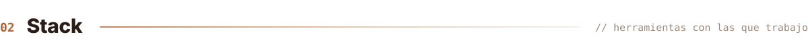
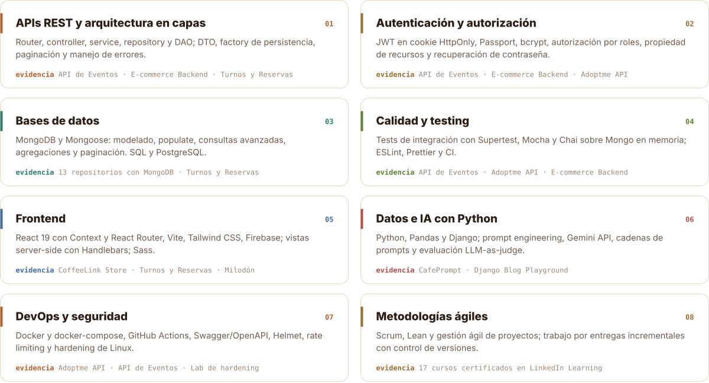
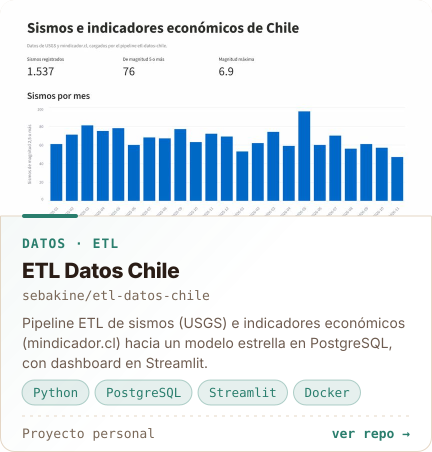
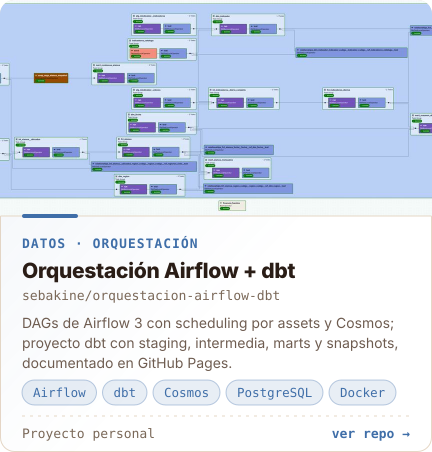
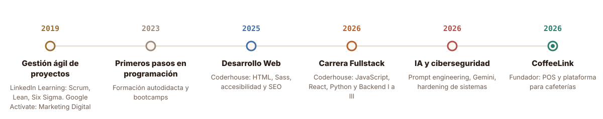
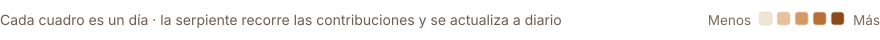

<!--
  Perfil de GitHub de Sebastián Muñoz Rivera.
  Los gráficos se generan con: python3 scripts/build.py  (editar textos en la sección DATOS)
-->

<picture>
  <source media="(prefers-color-scheme: dark)" srcset="assets/header-dark.svg">
  
</picture>

<!--
  CONTACTO (opcional). Para mostrarlo, quitar este comentario y completar los enlaces:
  

    
    
  

-->

<picture>
  <source media="(prefers-color-scheme: dark)" srcset="assets/sections/01-dark.svg">
  
</picture>

<picture>
  <source media="(prefers-color-scheme: dark)" srcset="assets/about-dark.svg">
  
</picture>

<picture>
  <source media="(prefers-color-scheme: dark)" srcset="assets/ahora-dark.svg">
  
</picture>

 

<picture>
  <source media="(prefers-color-scheme: dark)" srcset="assets/sections/02-dark.svg">
  
</picture>

<picture>
  <source media="(prefers-color-scheme: dark)" srcset="assets/tech-dark.svg">
  
</picture>

<picture>
  <source media="(prefers-color-scheme: dark)" srcset="assets/stack-dark.svg">
  
</picture>

<picture>
  <source media="(prefers-color-scheme: dark)" srcset="assets/skills-dark.svg">
  
</picture>

 

<picture>
  <source media="(prefers-color-scheme: dark)" srcset="assets/sections/03-dark.svg">
  
</picture>

<picture>
  <source media="(prefers-color-scheme: dark)" srcset="assets/coffeelink-dark.svg">
  
</picture>

  <a href="https://github.com/sebakine/etl-datos-chile"><picture><source media="(prefers-color-scheme: dark)" srcset="assets/projects/etl-datos-chile-dark.svg"></picture></a>
  <a href="https://github.com/sebakine/orquestacion-airflow-dbt"><picture><source media="(prefers-color-scheme: dark)" srcset="assets/projects/orquestacion-airflow-dbt-dark.svg"></picture></a>

  <a href="https://github.com/sebakine/CafePrompt"><picture><source media="(prefers-color-scheme: dark)" srcset="assets/projects/cafeprompt-dark.svg"></picture></a>
  <a href="https://github.com/sebakine/entrega-5-backend-2-coderhouse"><picture><source media="(prefers-color-scheme: dark)" srcset="assets/projects/entrega-5-backend-2-coderhouse-dark.svg"></picture></a>

  <a href="https://github.com/sebakine/adoptme-api"><picture><source media="(prefers-color-scheme: dark)" srcset="assets/projects/adoptme-api-dark.svg"></picture></a>
  <a href="https://github.com/sebakine/coffeelink-store-react"><picture><source media="(prefers-color-scheme: dark)" srcset="assets/projects/coffeelink-store-react-dark.svg"></picture></a>

**Más proyectos**

| Proyecto | Qué es | Stack |
|---|---|---|
| [**E-commerce Backend**](https://github.com/sebakine/ecommerce-backend-node) | Backend en capas DAO, Repository y DTO con Passport, roles y tickets de compra | Node.js · Express · MongoDB |
| [**Turnos y Reservas**](https://github.com/sebakine/entrega-final-backend-1-coderhouse) | Sistema construido en 8 etapas: de FileSystem a MongoDB, con Zod y Socket.io | Express 5 · Mongoose · Socket.io |
| [**Limpiador de datos**](https://github.com/sebakine/limpiador-datos) | CLI que limpia y valida CSV y Excel con datos de Chile: RUT, teléfonos, fechas y montos | Python · pandas · Typer |
| [**Monitor de precios**](https://github.com/sebakine/monitor-precios) | Monitor asíncrono con historial en SQLite y alertas por Telegram | Python · httpx · SQLite |
| [**Milodón Coffee Roasters**](https://github.com/sebakine/milodon-coffee-roasters-web) | Sitio de una tostaduría de Viña del Mar con carrito en JavaScript | HTML · Sass · Bootstrap |
| [**Django Blog Playground**](https://github.com/sebakine/django-blog-playground) | Blogs con CRUD y CKEditor, perfiles con avatar y mensajería entre usuarios | Python · Django |

 

<picture>
  <source media="(prefers-color-scheme: dark)" srcset="assets/sections/04-dark.svg">
  
</picture>

<picture>
  <source media="(prefers-color-scheme: dark)" srcset="assets/timeline-dark.svg">
  
</picture>

<picture>
  <source media="(prefers-color-scheme: dark)" srcset="assets/education-dark.svg">
  
</picture>

 

<picture>
  <source media="(prefers-color-scheme: dark)" srcset="assets/sections/05-dark.svg">
  
</picture>

<picture>
  <source media="(prefers-color-scheme: dark)" srcset="assets/activity-dark.svg">
  
</picture>

<picture>
  <source media="(prefers-color-scheme: dark)" srcset="https://raw.githubusercontent.com/sebakine/sebakine/output/snake-dark.svg">
  
</picture>

<picture>
  <source media="(prefers-color-scheme: dark)" srcset="assets/footer-dark.svg">
  
</picture>
