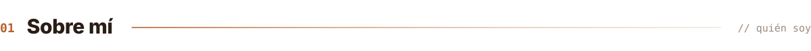
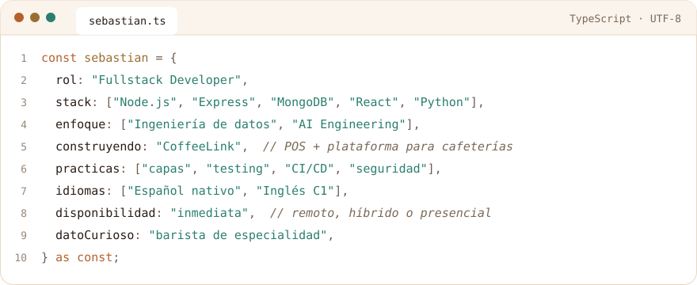
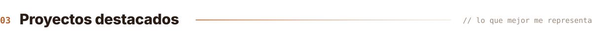
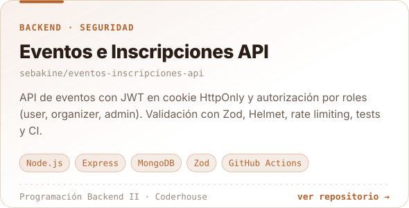
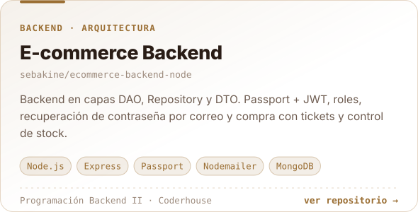
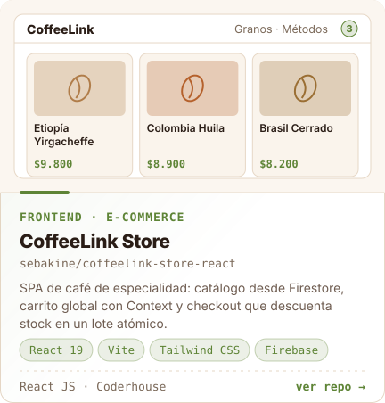

<!--
  Perfil de GitHub de Sebastián Muñoz Rivera.
  Los gráficos se generan con: python3 scripts/build.py  (editar textos en la sección DATOS)
-->

<picture>
  <source media="(prefers-color-scheme: dark)" srcset="assets/header-dark.svg">
  
</picture>

<!--
  CONTACTO (opcional). Para mostrarlo, quitar este comentario y completar los enlaces:
  

    
    
  

-->

<picture>
  <source media="(prefers-color-scheme: dark)" srcset="assets/sections/01-dark.svg">
  
</picture>

<picture>
  <source media="(prefers-color-scheme: dark)" srcset="assets/about-dark.svg">
  
</picture>

 

<picture>
  <source media="(prefers-color-scheme: dark)" srcset="assets/sections/02-dark.svg">
  
</picture>

<table>
  <tr>
    <td width="150"><b>Lenguajes</b></td>
    <td>
      <picture>
        <source media="(prefers-color-scheme: dark)" srcset="https://skillicons.dev/icons?i=ts,js,py,html,css&theme=dark">
        
      </picture>
    </td>
  </tr>
  <tr>
    <td><b>Backend</b></td>
    <td>
      <picture>
        <source media="(prefers-color-scheme: dark)" srcset="https://skillicons.dev/icons?i=nodejs,express,nestjs,mongodb,prisma,django&theme=dark">
        
      </picture>
    </td>
  </tr>
  <tr>
    <td><b>Frontend</b></td>
    <td>
      <picture>
        <source media="(prefers-color-scheme: dark)" srcset="https://skillicons.dev/icons?i=react,vite,tailwind,sass,electron,firebase&theme=dark">
        
      </picture>
    </td>
  </tr>
  <tr>
    <td><b>DevOps y herramientas</b></td>
    <td>
      <picture>
        <source media="(prefers-color-scheme: dark)" srcset="https://skillicons.dev/icons?i=docker,githubactions,git,linux,postman,vscode&theme=dark">
        
      </picture>
    </td>
  </tr>
</table>

 

<picture>
  <source media="(prefers-color-scheme: dark)" srcset="assets/sections/03-dark.svg">
  
</picture>

<picture>
  <source media="(prefers-color-scheme: dark)" srcset="assets/coffeelink-dark.svg">
  
</picture>

  <a href="https://github.com/sebakine/eventos-inscripciones-api"><picture><source media="(prefers-color-scheme: dark)" srcset="assets/projects/eventos-inscripciones-api-dark.svg"></picture></a>
  <a href="https://github.com/sebakine/adoptme-api"><picture><source media="(prefers-color-scheme: dark)" srcset="assets/projects/adoptme-api-dark.svg"></picture></a>

  <a href="https://github.com/sebakine/ecommerce-backend-node"><picture><source media="(prefers-color-scheme: dark)" srcset="assets/projects/ecommerce-backend-node-dark.svg"></picture></a>
  <a href="https://github.com/sebakine/entrega-final-backend-1-coderhouse"><picture><source media="(prefers-color-scheme: dark)" srcset="assets/projects/entrega-final-backend-1-coderhouse-dark.svg"></picture></a>

  <a href="https://github.com/sebakine/CafePrompt"><picture><source media="(prefers-color-scheme: dark)" srcset="assets/projects/cafeprompt-dark.svg"></picture></a>
  <a href="https://github.com/sebakine/coffeelink-store-react"><picture><source media="(prefers-color-scheme: dark)" srcset="assets/projects/coffeelink-store-react-dark.svg"></picture></a>

 

<picture>
  <source media="(prefers-color-scheme: dark)" srcset="assets/sections/04-dark.svg">
  
</picture>

<picture>
  <source media="(prefers-color-scheme: dark)" srcset="assets/education-dark.svg">
  
</picture>

 

<picture>
  <source media="(prefers-color-scheme: dark)" srcset="assets/sections/05-dark.svg">
  
</picture>

<picture>
  <source media="(prefers-color-scheme: dark)" srcset="https://raw.githubusercontent.com/sebakine/sebakine/output/snake-dark.svg">
  
</picture>

<picture>
  <source media="(prefers-color-scheme: dark)" srcset="assets/footer-dark.svg">
  
</picture>
